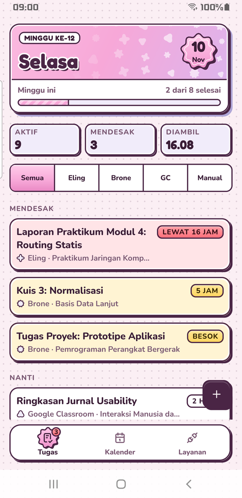
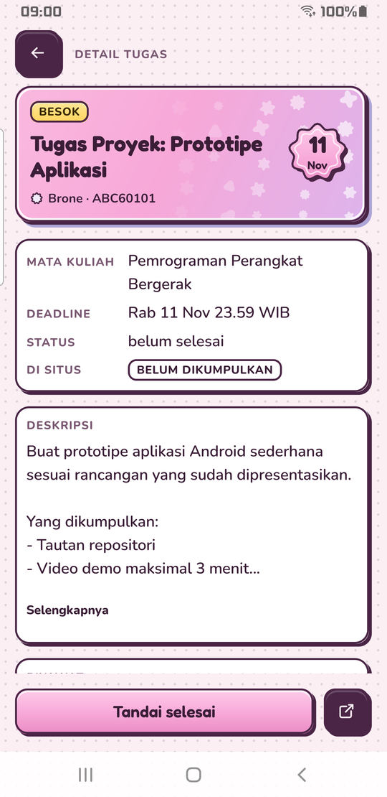
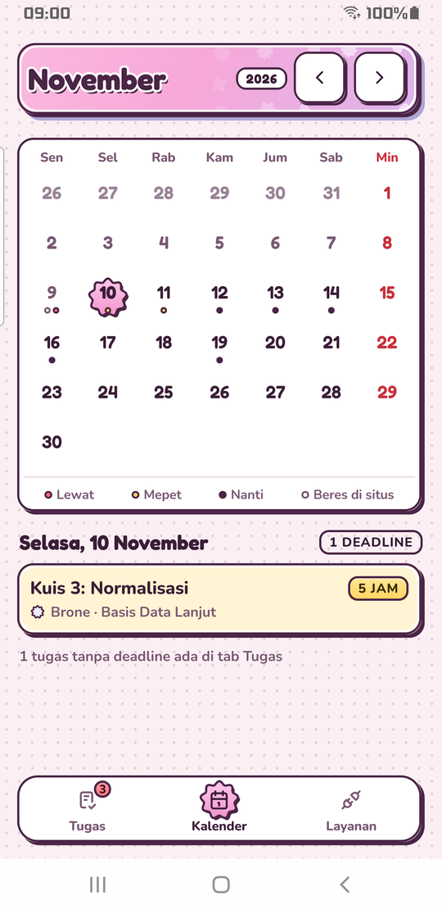
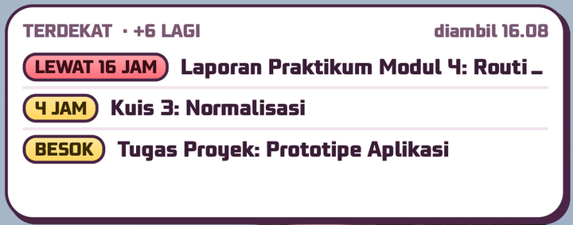

# Gwado

Aplikasi Android yang mengumpulkan tugas kuliah dari **Brone**, **Eling** (Moodle Universitas Brawijaya), dan **Google Classroom** ke satu daftar, lengkap dengan deadline, kalender, pengingat, dan widget.

Tidak ada server dan tidak ada akun Gwado. Tugas diambil langsung dari HP-mu, dan semua datanya tinggal di HP-mu.

**[Unduh APK](https://github.com/Quazzong/Gwado/releases)** · [Kebijakan privasi](docs/privasi.md)

<p>
  
  
  
</p>
<p></p>

<sub>Tangkapan layar memakai data contoh karangan.</sub>

## Fitur

- Tugas diambil otomatis beberapa kali sehari; tarik beranda ke bawah untuk mengambil saat itu juga.
- Tugas yang lewat atau tinggal kurang dari dua hari dikumpulkan di bagian **Mendesak**.
- Tugas yang sudah dikumpulkan atau ditandai selesai di situs otomatis dianggap beres (centangmu sendiri tidak diubah).
- Pengingat 3 hari dan 1 hari sebelum deadline, ringkasan pagi jam 07.00, dan alarm berdering 3 jam sebelum deadline.
- Kalender deadline dan dua widget layar utama.
- Tugas dari luar situs (misalnya grup WhatsApp) bisa ditambah sendiri.
- Tema terang, gelap, atau ikut sistem.

## Cara memasang

1. Unduh berkas `.apk` terbaru dari [Releases](https://github.com/Quazzong/Gwado/releases), lalu buka. Android akan meminta izin memasang dari sumber tak dikenal.
2. Di layar **Siapkan Gwado**, tambah layanan. Brone dan Eling dibuka di browser untuk login kampus. Kalau HP bertanya aplikasi mana yang membuka hasilnya, pilih **Gwado**.
3. Untuk Classroom, pilih akun Google yang dipakai kuliah lalu beri izin baca.
4. Setujui tebakan semester, lalu tekan **Mulai**.

> **Classroom masih tahap pengujian di Google.** Akun Google-mu harus didaftarkan dulu sebagai penguji. Tanpa itu Google menolak dengan `Error 403: access_denied`. Hubungi pembuat lewat [Issues](https://github.com/Quazzong/Gwado/issues) untuk didaftarkan. Brone dan Eling bisa dipakai tanpa ini.

## Tips

- **Saat ujian, nyalakan Jangan Ganggu.** Alarm 3 jam sebelum deadline tidak berdering selama Jangan Ganggu menyala; pengingat tetap muncul tanpa bunyi.
- Alarm yang sedang berdering bisa dimatikan dengan tombol power atau tombol volume, tanpa membuka HP.
- Di Android 14 ke atas, izinkan **Alarm & pengingat** untuk Gwado di pengaturan aplikasi supaya pengingat tepat waktu.

## Batasan

- Butuh Android 10 atau lebih baru.
- Hanya untuk Brone, Eling, dan Google Classroom. Gwado bukan aplikasi resmi universitas maupun Google.
- Data hanya ada di satu HP dan tidak ikut cadangan Google. Kalau pindah HP atau aplikasi dihapus, tugas diambil ulang dari situs, tapi centang dan tugas yang ditambah sendiri tidak ikut.
- Pengambilan otomatis tidak selalu tepat jam karena Android menghemat baterai. Beberapa merek HP juga mematikan aplikasi di latar belakang.
- Login Brone dan Eling memakai alamat `moodlemobile://`, sama dengan aplikasi Moodle resmi. Aplikasi lain bisa mendaftarkan alamat yang sama, jadi kalau HP bertanya, pastikan memilih **Gwado**.
- Database tugas disimpan tanpa enkripsi di folder privat aplikasi (sama seperti aplikasi Moodle resmi). Token login Brone dan Eling dienkripsi dengan Android Keystore; token Google dipegang Google Play services, bukan Gwado.
- Judul tugas bisa tampil di notifikasi layar kunci, mengikuti pengaturan notifikasi HP.

## Untuk pengembang

### Arsitektur singkat

- **Kotlin + Jetpack Compose**, komponen tampilan sendiri di atas Compose (bukan Material bawaan), Navigation 3, Glance untuk widget, WorkManager untuk pengambilan latar, `AlarmManager` untuk pengingat.
- **SQLite bawaan aplikasi** (`androidx.sqlite` + `BundledSQLiteDriver`) dengan SQL mentah dan migrasi bernomor di `app/src/main/resources/migrasi/`, tanpa Room.
- **Moodle Web Service** (`/webservice/rest/server.php`, token di badan POST) dan **Classroom API** dengan izin dari `AuthorizationClient` Google Play services. Klien HTTP cukup `HttpURLConnection`.
- Logika inti (parser, pengambilan, ingest, aturan semester, kalender, label waktu) ditulis sebagai fungsi murni tanpa Android, jadi bisa diuji di JVM tanpa HP.

| Paket | Isi |
|---|---|
| `sumber/` | Parser jawaban Moodle dan Classroom |
| `fetch/` | HTTP, klien Moodle/Google, jendela hindari + jeda |
| `ingest/`, `db/` | Penyimpanan hasil ambil ke database, migrasi |
| `tugas/`, `kalender/`, `waktu/`, `segar/`, `semester/` | Daftar, detail, tugas manual, kalender, label sisa waktu, status sumber |
| `layanan/`, `masuk/` | Login Moodle, izin Google, alur Ambil |
| `penjadwal/`, `pengingat/`, `widget/` | Pengambilan latar, notifikasi + alarm, widget |
| `ui/` | Tema, komponen, layar |

### Kontrak golden

Logika Gwado adalah terjemahan dari implementasi Python milik pembuat. Kebenarannya dibuktikan dengan **golden file** netral bahasa di `app/src/test/resources/kontrak/`: fixture jawaban API (isinya karangan, bukan data asli siapa pun) dan hasil yang diharapkan. Test Kotlin harus menghasilkan keluaran yang sama persis. File kontrak tidak diedit manual di repo ini.

### Build dan test

Butuh Android Studio (JDK bawaannya) dan Android SDK.

```sh
./gradlew :app:testDebugUnitTest   # unit test JVM, tanpa HP
./gradlew :app:installDebug        # pasang di HP lewat USB
```

Build rilis butuh `keystore.properties` di root repo (tidak ikut repo). Tanpa file itu, `assembleRelease` menghasilkan APK tanpa tanda tangan.

Modul `baselineprofile/` membuat Baseline Profile untuk mempercepat buka aplikasi. Task Gradle yang memakai perangkat (`connected*`, `generate*BaselineProfile`) meng-uninstall aplikasi di semua perangkat yang tersambung, jadi cabut HP yang datanya ingin dijaga.

Kode ditulis bersama asisten AI (Claude). Rancangan, keputusan, desain tampilan, dan pengujian di HP dikerjakan pembuat.

## Lisensi

Lisensi kode belum ditentukan. Font Fredoka dan Nunito memakai SIL Open Font License, ikon Tabler Icons memakai lisensi MIT; teksnya ada di `app/src/main/assets/lisensi/`.

## Kontak

Masalah atau pertanyaan: [GitHub Issues](https://github.com/Quazzong/Gwado/issues). Issues bisa dibaca publik, jadi jangan menulis token, NIM, atau data pribadi lain di sana.
